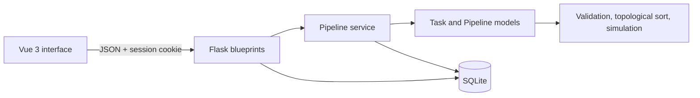

# PipelinePilot

PipelinePilot is a visual CI/CD pipeline scheduler for cloud-computing beginners. It lets a learner model tasks and dependencies, detect invalid pipelines, and see how a limited worker pool changes total execution time.

## Features

- Test-stage administrator authentication using a Flask session
- Persistent Pipeline and Task CRUD with SQLite
- Task duration and dependency editing
- Dependency validation and cycle detection
- Deterministic topological execution order
- Event-driven simulation with 1-20 workers
- Visual dependency graph and per-worker timeline
- Responsive Vue interface with loading, error, empty, confirmation, and 404 states
- Automated model and API tests plus GitHub Actions CI

## Architecture



```text
9001_pipeline_pilot/
├── backend/
│   ├── models/             # Core Task and Pipeline domain logic
│   ├── routes/             # Authentication, Pipeline, and Task HTTP endpoints
│   ├── services/           # Database-to-domain transformations
│   ├── tests/              # unittest model and API coverage
│   ├── app.py              # Flask application factory
│   └── database.py         # SQLite schema and lightweight migration
├── frontend/
│   └── src/
│       ├── api/            # HTTP request functions
│       ├── components/     # Graph, timeline, and confirmation UI
│       ├── views/          # Login, dashboard, editor, and 404 pages
│       └── auth.js         # Reactive session state
└── .github/workflows/ci.yml
```

## Requirements

- Python 3.9 or later
- Node.js 24 (Node 22.18 or later is also supported)
- npm

## Setup

### Backend

```bash
cd backend
python3 -m venv .venv
source .venv/bin/activate
python -m pip install -r requirements.txt
python app.py
```

The API runs at `http://localhost:5001`. Port 5001 is used because macOS AirPlay may occupy port 5000.

### Frontend

In a second terminal:

```bash
cd frontend
npm install
npm run dev
```

Open `http://localhost:5173`.

## Test Access

PipelinePilot is explicitly presented as a test-stage application. The default local credentials are:

```text
Username: Chris
Password: 123
```

These credentials are for a local teaching demonstration, not production authentication. They can be overridden with environment variables:

```bash
export PIPELINE_PILOT_ADMIN_USERNAME="Chris"
export PIPELINE_PILOT_ADMIN_PASSWORD="123"
export PIPELINE_PILOT_SECRET_KEY="replace-this-for-shared-deployments"
export PIPELINE_PILOT_CORS_ORIGINS="http://localhost:5173,http://127.0.0.1:5173"
```

The frontend API URL can be changed by copying `frontend/.env.example` to `frontend/.env` and editing `VITE_API_BASE_URL`.

## Typical Demo

1. Sign in and create a Pipeline.
2. Open it and add `Install` with a duration of 2 seconds.
3. Add `Test` and `Build`, both depending on `Install`.
4. Add `Deploy`, depending on both `Test` and `Build`.
5. Validate to show the topological execution order.
6. Run with one worker, then two workers, and compare total duration.
7. Inspect the dependency graph and worker timeline.

## Scheduling Logic

Pipeline validation confirms that every dependency exists and then detects cycles. A topological sort produces a valid execution order. The simulation advances directly to the next completion event instead of ticking one second at a time:

1. Select ready tasks whose dependencies are complete.
2. Assign them to available workers.
3. Advance time to the nearest task completion.
4. Release workers and repeat until every task finishes.

This keeps the simulation efficient while exposing parallel execution clearly.

## Tests

Run the backend suite:

```bash
cd backend
source .venv/bin/activate
python -m unittest discover -s tests -v
```

Run frontend quality checks:

```bash
cd frontend
npm exec -- oxlint .
npm exec -- eslint .
npm run build
```

GitHub Actions runs the same checks on every push and pull request.

## API Summary

| Method | Endpoint | Purpose |
| --- | --- | --- |
| `POST` | `/api/auth/login` | Start administrator session |
| `POST` | `/api/auth/logout` | Clear session |
| `GET` | `/api/auth/session` | Inspect session |
| `GET/POST` | `/api/pipelines` | List or create pipelines |
| `GET/PATCH/DELETE` | `/api/pipelines/:id` | Read, rename, or delete a pipeline |
| `POST` | `/api/pipelines/:id/tasks` | Create a task |
| `PATCH/DELETE` | `/api/tasks/:id` | Edit or delete a task |
| `POST` | `/api/pipelines/:id/validate` | Validate dependencies and order |
| `POST` | `/api/pipelines/:id/simulate` | Simulate limited workers |

## Scope and Security

This is an educational single-administrator prototype. A production version would require password hashing, user storage, CSRF protection, HTTPS, secret management, database migrations, audit logging, and deployment hardening.
